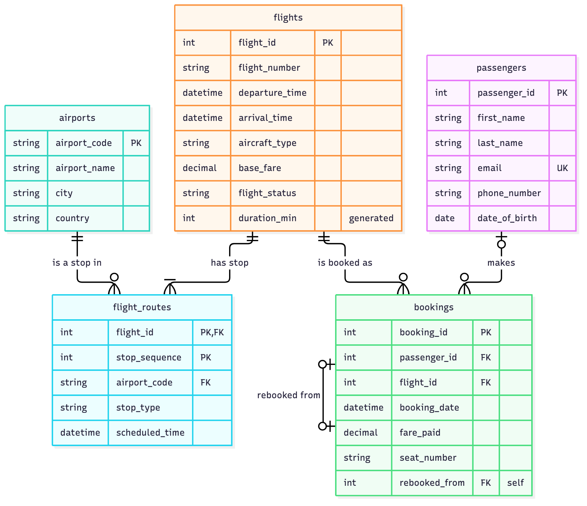

# Airline Booking Database

A PostgreSQL database that models an airline's booking system — passengers, flights, bookings, airports, and the routes connecting them.

## Project Overview

This repository contains my EX 603 course project: a PostgreSQL relational database for an airline booking system that organizes passengers, flights, bookings, airports, and flight routes.

The project will be developed incrementally across Units 1–6. It will begin with a relational data model and schema, then expand to include SQL queries, multi-table joins, data analysis, written reflections, and a final video presentation.

## Chosen Theme

I selected the **Airline Booking** theme. The database will model the following five roles required by the project:

| Database role | Table           | Purpose                                                       |
| -------------- | --------------- | -------------------------------------------------------------- |
| Actor          | `passengers`    | Stores information about passengers who make bookings.         |
| Producer       | `flights`       | Stores the flights available for passengers to book.           |
| Event          | `bookings`      | Records each booking, including its date and the fare paid.    |
| Catalog        | `airports`      | Stores descriptive information about airports.                 |
| Junction       | `flight_routes` | Connects flights and airports in a many-to-many relationship.  |

The main numeric metric for the project is `fare_paid`. As the project develops, the database will support questions such as which flights receive the most bookings, how much revenue flights generate, which passengers book most frequently, and which airports are associated with particular routes.

## Domain

The Airline Booking database models the core operations of an airline's booking platform: passengers, the flights they can book, the bookings themselves, the airports those flights touch, and the routes connecting flights to airports. It's designed to reflect how a real airline reservation system behaves — flights can include layovers across multiple airports, passengers accumulate a history of bookings over time, and every booking carries a fare that contributes to the platform's revenue.

The database needs to answer a consistent set of business questions as the project develops: which flights receive the most bookings, how much revenue each flight generates, which passengers book most frequently, and which airports are associated with which routes. These questions shaped several of the schema's design decisions — for example, routing every flight-to-airport relationship through a dedicated `flight_routes` table, rather than storing departure and arrival airports directly on `flights`, makes it possible to model flights with more than one stop and to answer airport-level questions without a separate structure for layovers.

The full entity-relationship diagram below shows how the five relations connect.



## Schema

The full DDL is in [`schema/schema.sql`](schema/schema.sql); the reasoning behind each constraint is in [`analysis/unit2.md`](analysis/unit2.md).

| # | Table | Role | Key | References |
|---|---|---|---|---|
| 1 | `passengers` | Actor | `passenger_id` (identity) | — |
| 2 | `airports` | Catalog | `airport_code` (natural IATA code) | — |
| 3 | `flights` | Producer | `flight_id` (identity) | — |
| 4 | `flight_routes` | Junction | `(flight_id, stop_sequence)` composite | `flights`, `airports` |
| 5 | `bookings` | Event | `booking_id` (identity) | `passengers`, `flights`, `bookings` |

Design decisions worth noticing:

- **Recursive foreign key on `bookings.rebooked_from`.** When a passenger changes flights, the new booking points at the one it replaced, forming a change history.
- **Composite key on the junction.** `flight_routes` is keyed by `(flight_id, stop_sequence)`, not by the two foreign keys, because the order of stops is what the table records.
- **Deletes preserve history.** Deleting a passenger anonymizes their bookings (`SET NULL`) rather than erasing revenue; flights with bookings and airports with routes cannot be deleted (`RESTRICT`); a cancelled flight is recorded with `flight_status`.
- **All timestamps are UTC**, which keeps the `arrival_time > departure_time` check valid across time zones and lets `duration_min` be a stored generated column.
- **Every constraint is named** (`pk_`, `fk_`, `uq_`, `chk_`), so errors point directly at the rule that was broken.

## Data Used From Unit 3 Onward

**Assignments from Unit 3 onward use the course-provided Unit 3 schema, not my Unit 1–2 schema.** Units 1–2 were practice in designing a database, and `schema/schema.sql` stays in this repo as that work. For query practice, everyone in the Airline Booking theme uses the same provided schema and dataset, **`ex603_data`**, and it will be used for the rest of the course. It follows the same roles — passengers make bookings on flights, and flights connect to airports through routes — but its columns differ from my schema:

| | My schema (`schema/schema.sql`) | `ex603_data` |
|---|---|---|
| Airports | keyed by IATA `airport_code` | keyed by `airport_id` |
| Routes | `stop_sequence` for multi-stop flights | `effective_from` date |
| Bookings | `rebooked_from` change history | `booking_country`, `booking_status`, `cancellation_reason`, `bags_kg`, `fare_multiplier` |
| Extra table | — | `flight_services` |
| Deleting a passenger | `SET NULL` | `RESTRICT` |

All queries and analysis from Unit 3 onward describe `ex603_data`. It contains 200 bookings, 30 passengers, 15 flights, and 5 airports.

## Project Status

This project has completed **Unit 4: aggregation**. Unit 1 produced the relation schemas, ERD, integrity constraints, and written analysis. Unit 2 translated them into a working PostgreSQL schema (`schema/schema.sql`), updated the ERD where implementation changed the design, and documented every foreign key and CHECK decision in `analysis/unit2.md`. Unit 3 audited the booking data with filtering, NULL handling, and subqueries, and found that the dashboard's 50% failure rate was really 6% (`analysis/unit3-finding.md`). Unit 4 summarized the platform with aggregate functions, GROUP BY, HAVING, conditional aggregation, ROLLUP, and CTEs, and identified the flights to investigate (`analysis/unit4.md`, `analysis/unit4-finding.md`).

## Planned Repository Structure

```
.
├── README.md
├── schema/
│   ├── schema.sql
│   ├── schema-definition.md
│   ├── constraints.md
│   ├── erd.png
│   └── erd.mmd
├── queries/
│   ├── q3_1.sql, q3_2.sql, q3_3.sql   (Unit 3)
│   ├── unit4/
│   │   ├── q4_1.sql
│   │   └── q4_2.sql
│   ├── unit5/
│   └── unit6/
├── analysis/
│   ├── unit1.md
│   ├── unit2.md
│   ├── unit3-finding.md
│   ├── unit4.md
│   └── unit4-finding.md
└── screenshots/
    ├── unit2/
    ├── unit3/
    └── unit4/
```

## Technology

- PostgreSQL 14 or later
- A PostgreSQL client DataGrip, or `psql`
- Git and GitHub for version control and project presentation

## How to Run the Project

Requires PostgreSQL 14 or later. Create an empty database, then run the schema script from the repository root:

```bash
createdb airline_booking
psql -d airline_booking -v ON_ERROR_STOP=1 -f schema/schema.sql
psql -d airline_booking -c '\dt'
```

The script starts with a reset block, so it can be re-run at any time without manual cleanup.

## Query Catalogue

Queries and the business questions they answer will be documented here as they are completed.

| Unit   | Query or topic | Business question | Status      |
| ------ | --------------- | ------------------ | ------------ |
| Unit 3 | [`q3_1.sql`](queries/q3_1.sql) 3.1a–g — what the data contains | Which active flights are largest, what booking statuses exist, which bookings fall in a fare range or status list, which flights start with VN, which bookings lack a cancellation reason, and how flights group by capacity? | Complete |
| Unit 3 | [`q3_2.sql`](queries/q3_2.sql) 3.2A — the rows that vanished | Why does filtering on `cancellation_reason != 'Passenger no show'` miss 166 bookings, and how is it fixed? | Complete |
| Unit 3 | [`q3_2.sql`](queries/q3_2.sql) 3.2B — the alias that did not exist yet | Why can't a SELECT alias be used in WHERE, and what are two ways around it? | Complete |
| Unit 3 | [`q3_3.sql`](queries/q3_3.sql) 3.3 — corrected query, three ways | Which passengers have at least one disputed booking, and do IN, a CTE, and EXISTS give identical answers? | Complete |
| Unit 4 | [`q4_1.sql`](queries/unit4/q4_1.sql) 4.1.1 — platform totals | How many bookings, how much fare, what average/lowest/highest fare, and how many distinct passengers does the platform have? | Complete |
| Unit 4 | [`q4_1.sql`](queries/unit4/q4_1.sql) 4.1.1b — zero-fare check | Are the $0.00 fares spread across all bookings, or do they belong to one booking status? | Complete |
| Unit 4 | [`q4_1.sql`](queries/unit4/q4_1.sql) 4.1.2 — bookings per flight | How many bookings and what average fare does each flight have, busiest first? | Complete |
| Unit 4 | [`q4_1.sql`](queries/unit4/q4_1.sql) 4.1.3 — HAVING threshold | Which flights have at least 15 bookings, enough for their no-show rate to mean something? | Complete |
| Unit 4 | [`q4_1.sql`](queries/unit4/q4_1.sql) 4.1.4 — region × status | How do bookings and fares break down by booking country and booking status? | Complete |
| Unit 4 | [`q4_2.sql`](queries/unit4/q4_2.sql) Part A — conditional aggregation | For each flight, how many bookings and how many no-shows, side by side? | Complete |
| Unit 4 | [`q4_2.sql`](queries/unit4/q4_2.sql) Part B — ROLLUP | What are each region's subtotals and the platform grand total? | Complete |
| Unit 4 | [`q4_2.sql`](queries/unit4/q4_2.sql) Part C — CTE pipeline | What is the baseline no-show rate, cancellation rate, and fare for high-volume flights? | Complete |
| Unit 5 | To be added     | To be added         | Not started |
| Unit 6 | To be added     | To be added         | Not started |

## Technical Highlights

Technical highlights will be added as the schema and queries are developed.

## What I Would Do Differently

This reflection will be completed near the end of the project after the database has been designed, implemented, and tested.

## Video Presentation

The final 8–12 minute video presentation will be linked here in Unit 6.

## Academic and Security Note

This repository is an academic project created for EX 603. It must not contain passwords, database connection strings, API keys, or personal data.
