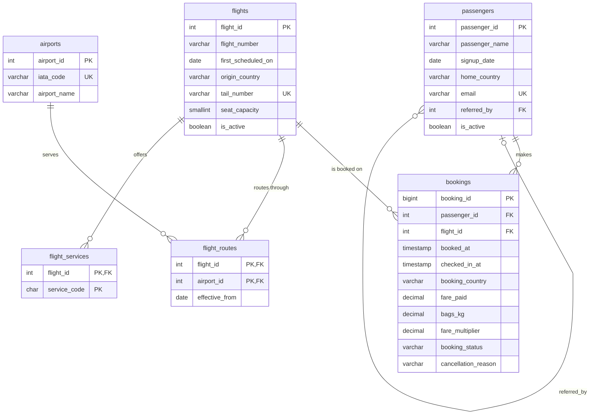

# Airline Booking Database: Design and SQL Analysis

A PostgreSQL project in two parts: I designed a relational database for an airline booking platform, then used SQL on the course dataset to find that a dashboard's 50% failure rate was really 6%, trace the failures to specific flights, and measure whether the platform improved over 2023.

## The Domain

The platform sells seats on scheduled flights. Passengers book a flight, pay a fare, and each booking ends one of three ways: **confirmed**, **cancelled** (with a reason: passenger no-show, passenger cancellation, flight cancelled by the airline, or failed payment), or **disputed**. Cancelled fares are refunded to $0. Flights route through airports, and each flight has a seat capacity and an active/inactive status.

The project began with a problem. A leadership dashboard reported that about half of all bookings failed, and on that basis leadership froze the quarterly route-profitability payout. Over six units I worked through the questions that followed: **Is the failure rate real? Where does it come from: particular flights, passengers, airports or aircraft? Are some flights failing in a way the dashboard can't even see? And is the platform getting better or worse?**

Each unit used a new set of SQL tools on the same data. Unit 3 filtered and audited, Unit 4 aggregated, Unit 5 joined, and Unit 6 used window functions to look at change over time. The analysis is written up after each unit as a short memo to leadership, linked in the [Query catalogue](#query-catalogue).

## Database Overview

All analysis runs on **`ex603_data`**, the Airline Booking dataset and schema provided by the course in Unit 3 (`airline.sql`). It holds 2023 data: **200 bookings, 30 passengers, 15 flights, 5 airports, 25 flight routes and 28 flight services**. All passenger names and emails are synthetic (`Passenger_01`, `@example.com`).



The ERD source is also in [`schema/ex603_data-erd.mmd`](schema/ex603_data-erd.mmd).

| Table | Role | What it holds | How the analysis uses it |
|---|---|---|---|
| `bookings` | Event | One row per booking: when it was made, the fare paid, status and cancellation reason | The center of every query. `fare_paid` is the metric. `booking_status` and `cancellation_reason` define failure. `booked_at` drives the time series in Unit 6. |
| `flights` | Producer | Flight number, seat capacity, origin, active flag | Every per-flight comparison, leaderboard and gap search |
| `passengers` | Actor | Synthetic passenger profiles | Checking whether failures come from a few repeat passengers (they don't) |
| `airports` | Catalog | 5 airports by IATA code | Finding the airport the flagged flights share (SIN) |
| `flight_routes` | Junction | Which airports each flight serves | Many-to-many link between flights and airports |
| `flight_services` | Child of flights | Service codes per flight | Not used in the analysis |

`cancellation_reason` is NULL for every confirmed and disputed booking. That NULL turned out to be the cause of the dashboard error (see [Findings](#findings-and-recommendations)).

**Earlier design work.** In Units 1–2 I designed my own airline schema before the shared dataset was provided. It is kept in [`schema/schema.sql`](schema/schema.sql), with its ERD in [`schema/erd.png`](schema/erd.png) and the design reasoning in [`analysis/unit1.md`](analysis/unit1.md) and [`analysis/unit2.md`](analysis/unit2.md). Everything from Unit 3 on uses `ex603_data`, not that schema.

## Query Catalogue

Every `.sql` file starts with a header naming the task and the question it answers, and every query is followed by a comment with its result. Screenshots of each query running are in [`screenshots/`](screenshots/).

### Unit 3: Filtering, NULLs and subqueries ([memo](analysis/unit3-finding.md))

| Query | Business question |
|---|---|
| [`q3_1.sql`](queries/q3_1.sql) 3.1a–g | What does the data contain: largest active flights, booking statuses, fares in a range, VN flights, missing cancellation reasons, capacity groups? |
| [`q3_2.sql`](queries/q3_2.sql) Part A | Why does `cancellation_reason != 'Passenger no show'` miss 166 bookings, and how is it fixed? |
| [`q3_2.sql`](queries/q3_2.sql) Part B | Why can't a SELECT alias be used in WHERE, and what are two ways around it? |
| [`q3_3.sql`](queries/q3_3.sql) | Which passengers have a disputed booking, and do IN, a CTE and EXISTS agree? |

### Unit 4: Aggregation ([analysis](analysis/unit4.md), [memo](analysis/unit4-finding.md))

| Query | Business question |
|---|---|
| [`q4_1.sql`](queries/unit4/q4_1.sql) 4.1.1 | What are the platform's totals: bookings, fare revenue, average/min/max fare, distinct passengers? |
| [`q4_1.sql`](queries/unit4/q4_1.sql) 4.1.1b | Are the $0 fares spread out, or do they all belong to cancelled bookings? |
| [`q4_1.sql`](queries/unit4/q4_1.sql) 4.1.2–4.1.3 | How many bookings does each flight have, and which have at least 15, enough to trust their no-show rate? |
| [`q4_1.sql`](queries/unit4/q4_1.sql) 4.1.4 | How do bookings and fares break down by booking country and status? |
| [`q4_2.sql`](queries/unit4/q4_2.sql) Part A | For each flight, how many bookings and how many no-shows, side by side? |
| [`q4_2.sql`](queries/unit4/q4_2.sql) Part B | What are each region's subtotals and the grand total (ROLLUP)? |
| [`q4_2.sql`](queries/unit4/q4_2.sql) Part C | What is the benchmark no-show rate for high-volume flights? |

### Unit 5: Joins ([analysis](analysis/unit5.md), [memo](analysis/unit5-finding.md))

| Query | Business question |
|---|---|
| [`q5_1.sql`](queries/unit5/q5_1.sql) 5.1.1 | Who made each booking on the flagged flights, and how did each one end? |
| [`q5_1.sql`](queries/unit5/q5_1.sql) 5.1.2 | Which airport do the flagged flights share? |
| [`q5_1.sql`](queries/unit5/q5_1.sql) 5.1.3 | How do the flagged flights compare with flights of the same seat capacity (self join)? |
| [`q5_2.sql`](queries/unit5/q5_2.sql) Parts A–C | Which flights does an INNER JOIN silently drop, and do LEFT, RIGHT, FULL OUTER, NOT EXISTS and EXCEPT agree on which ones? |
| [`q5_3.sql`](queries/unit5/q5_3.sql) Part A | When is a CROSS JOIN useful, and when is it a mistake? |
| [`q5_3.sql`](queries/unit5/q5_3.sql) Part B | Which join algorithms does PostgreSQL choose for the three-table join, and why? |

### Unit 6: Window functions ([analysis](analysis/unit6.md), [closing memo](analysis/unit6-finding.md))

| Query | Business question |
|---|---|
| [`q6_1.sql`](queries/unit6/q6_1.sql) 6.1.1 | Is a booking's fare unusual for its own flight? (window AVG vs. GROUP BY) |
| [`q6_1.sql`](queries/unit6/q6_1.sql) 6.1.2 | Where does each flight land on a bookings leaderboard under ROW_NUMBER, RANK and DENSE_RANK? |
| [`q6_1.sql`](queries/unit6/q6_1.sql) 6.1.3 | Which quartile band is each flight in, and what happens to tied flights at a boundary (NTILE)? |
| [`q6_2.sql`](queries/unit6/q6_2.sql) Part A | Is VN202's fare going up or down from one booking to the next (LAG/LEAD)? |
| [`q6_2.sql`](queries/unit6/q6_2.sql) Part B | How close did revenue get to a $1,000-per-quarter target, and what is the smoothed cancellation rate (running total, moving average)? |
| [`q6_2.sql`](queries/unit6/q6_2.sql) Part C | Which flights stopped getting bookings for 60+ days, and was that a real stop or lost data? |
| [`q6_3.sql`](queries/unit6/q6_3.sql) Part A | What are each flight's top three fares (top-N per group, FIRST_VALUE/LAST_VALUE)? |
| [`q6_3.sql`](queries/unit6/q6_3.sql) Part B | Is the platform getting better or worse month over month and quarter over quarter? |

## Technical Highlights

1. **Catching a NULL trap (Unit 3, again in Unit 6).** `WHERE cancellation_reason != 'Passenger no show'` returned 22 rows instead of 188, because comparing NULL to anything gives NULL, not true. The 166 confirmed and disputed bookings vanished from the result. The fix was adding `OR cancellation_reason IS NULL`. The same trap appeared in Unit 6, inside a moving average: a 0/1 flag built from `cancellation_reason = 'Passenger no show'` is NULL for those bookings, so `AVG` skips them and overstates the no-show rate. A `CASE ... THEN 1 ELSE 0` fixed it. This is the kind of bug that produces a dashboard nobody believes.
2. **Conditional aggregation and a benchmark CTE (Unit 4).** `COUNT(*) FILTER (WHERE ...)` put bookings, no-shows and cancellations side by side per flight in one pass. A CTE then built a fair benchmark from flights with at least 15 bookings (4.8% no-shows), so a flight with 6 bookings and 1 no-show isn't flagged as a 17% problem.
3. **Outer joins to find what isn't there (Unit 5).** An INNER JOIN between flights and bookings drops flights with no bookings, so every earlier report missed **VN214 and VN215**, two active flights that were never booked. A LEFT JOIN found them, and NOT EXISTS, EXCEPT and FULL OUTER JOIN confirmed the result three independent ways.
4. **Window functions for change over time (Unit 6).** `LAG` over each flight's bookings found a 113-day silence on VN209. A running `SUM ... ROWS BETWEEN UNBOUNDED PRECEDING AND CURRENT ROW` showed each quarter's progress toward its revenue target. A 30-booking moving average turned noisy monthly counts into a readable cancellation trend. GROUP BY can't do any of these without losing the individual rows.
5. **Guarding comparisons against bad denominators and missing periods (Unit 6).** Month-over-month percent change uses `NULLIF(previous, 0)` to avoid division by zero. The monthly series is built from `GENERATE_SERIES`, so `LAG` always compares a month with the calendar month before it, even if a month has no bookings.

## Findings and Recommendations

1. **The real failure rate was 6%, not 50%.** 12 of 200 bookings were passenger no-shows; all cancellations together were 17% [Unit 3]. The likely cause of the dashboard error is the NULL comparison above. **Recommendation:** correct the dashboard logic and reassess the payout freeze on the real figure.
2. **Failures concentrate in specific flights, and fell over the year.** The five 320-seat flights have a 10.9% no-show rate against 3.7% for all others, led by VN202 (18.8%) [Unit 5]. Platform-wide, no-shows fell every quarter (7.5% to 4.2%), and the cancellation rate dropped from 22.6% in Q1 to about 15% for the rest of the year [Unit 6]. **Recommendation:** run 24-hour check-in reminders on the 320-seat flights and hold no-shows at or below 4.8% and cancellations at or below 15% next quarter.
3. **Volume, not failure, is now the bigger problem.** Bookings were flat (48–53 per quarter), and revenue missed a $1,000-per-quarter target in three of four quarters (year: 90.7% of $4,000). VN209 went 113 days without a booking while the rest of the platform kept selling, and VN214 and VN215 never sold at all [Units 5–6]. **Recommendation:** confirm with scheduling which flights were off sale, put them back on sale or retire them, and track revenue against target weekly with the running-total query.

The full argument, with the query behind every number, is in the [closing memo](analysis/unit6-finding.md).

## Limitations and Future Improvements

**The dataset is too small to prove a trend.** There are 200 bookings over one year, about 50 a quarter. The fall in no-shows from Q1 to Q4 is 4 bookings to 2. The direction is consistent across all four quarters, but a change that size could also happen by chance, and with one year there is no way to separate seasonality from improvement. The data also can't explain *why* things happened. There is no flight schedule, departure date, sales-channel or search history, so I can show that VN209 stopped selling for 113 days but not whether it was taken off sale or was on sale with no demand.

**What would help:**
- **More data:** at least two years of bookings, to compare each quarter with the same quarter a year earlier and to test whether the no-show drop is statistically significant (for example, a two-proportion test).
- **A schedule and availability table:** when each flight was on sale and when it departed, to tell a real stop from a flight nobody could book.
- **A rule that a cancelled booking must have a reason.** In this data, an empty `cancellation_reason` always means "not cancelled": all 34 cancelled bookings have a reason. The provided schema doesn't enforce that, though, so in a live system a cancellation saved without a reason would look exactly like a confirmed booking. A constraint closes that gap:

  ```sql
  ALTER TABLE bookings
    ADD CONSTRAINT ck_bookings_cancel_reason
    CHECK ((booking_status = 'cancelled') = (cancellation_reason IS NOT NULL));
  ```

  It requires a reason on every cancelled booking and forbids one on any other booking. It passes on all 200 current bookings.
- **Check-in reminder logs:** if the team runs the recommended reminders, a record of who received one would allow a before-and-after comparison instead of an inference.

## Video Presentation

**[▶ Watch the presentation on Loom (4:20)](https://www.loom.com/share/d87175352e33469199ecd28c610b7622)**

The video covers the business question, three representative queries (the NULL filter from Unit 3 and two Unit 6 window-function queries), the findings and recommendations, and the main challenge and limitation.

## How to Run It

Requires PostgreSQL 14 or later and the `psql` client. From a terminal:

1. Create the database and load the course-provided Unit 3 dataset, `airline.sql` (schema and data in one file; it drops and recreates its tables, so it is safe to re-run):

   ```bash
   createdb ex603_data
   ```

   ```bash
   psql -d ex603_data -v ON_ERROR_STOP=1 -f airline.sql
   ```

2. Clone this repository and run any query file from its root, for example the Unit 6 window-function queries:

   ```bash
   git clone https://github.com/irodriguez2011/ex603-airline-booking-database.git
   ```

   ```bash
   cd ex603-airline-booking-database && psql -d ex603_data -f queries/unit6/q6_1.sql
   ```

   Add `-a` to echo each query above its result, as in the screenshots.

3. Optional: the Units 1–2 design schema can be built in a separate, empty database:

   ```bash
   createdb airline_booking && psql -d airline_booking -v ON_ERROR_STOP=1 -f schema/schema.sql
   ```

## Repository Structure

```
.
├── README.md
├── schema/
│   ├── ex603_data-erd.mmd        ERD of the provided dataset (Units 3–6)
│   ├── schema.sql                my Units 1–2 design schema
│   ├── schema-definition.md, constraints.md, erd.png, erd.mmd
├── queries/
│   ├── q3_1.sql, q3_2.sql, q3_3.sql
│   ├── unit4/  q4_1.sql, q4_2.sql
│   ├── unit5/  q5_1.sql, q5_2.sql, q5_3.sql
│   └── unit6/  q6_1.sql, q6_2.sql, q6_3.sql
├── analysis/
│   ├── unit1.md, unit2.md
│   ├── unit3-finding.md
│   ├── unit4.md, unit4-finding.md
│   ├── unit5.md, unit5-finding.md
│   └── unit6.md, unit6-finding.md
└── screenshots/
    └── unit2/ … unit6/
```

## Academic and Security Note

This repository is an academic project for EX 603. It contains no passwords, connection strings, API keys or real personal data. All passenger records in the dataset are synthetic.
